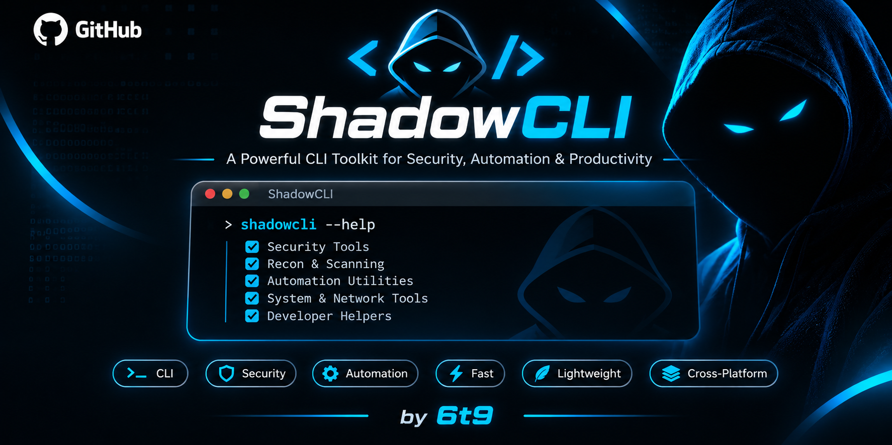

<div align="center">



<br/><br/>

# ⚡ ShadowCLI

### *The Zero-Trust Execution Layer for AI Coding Agents*

[](https://github.com/6t9xstar/shadowcli/actions/workflows/ci.yml)
[](https://www.rust-lang.org)
[](https://kernel.org)
[](docs/security-model.md)
[](LICENSE)
[](https://github.com/sponsors/6t9xstar)
[](https://buymeacoffee.com/6t9xstar)

<p align="center">
  <a href="#-quickstart">Quickstart</a> •
  <a href="#-why-shadowcli">Why ShadowCLI?</a> •
  <a href="#-supported-ai-coding-agents">Supported Agents</a> •
  <a href="#-architecture--isolation">Architecture</a> •
  <a href="#-command-reference">Commands</a> •
  <a href="#-security-guarantees">Security Guarantees</a> •
  <a href="#-support--sponsorship">Sponsor</a>
</p>

---

</div>

## 📌 What is ShadowCLI?

Autonomous AI coding agents (**Claude Code**, **OpenHands**, **Codex**, **Aider**, and custom LLM runners) execute bash commands, compile code, and mutate files. 

Giving autonomous agents unrestricted access to your developer machine is inherently dangerous: prompt injection, hallucinations, or rogue scripts can silently leak your `~/.ssh` keys, wipe `.git` history, overwrite `.env` secrets, or install backdoor dependencies.

**ShadowCLI** intercepts agent commands and runs them inside an **unprivileged, defense-in-depth Linux sandbox**. Every file modification is quarantined in an ephemeral copy-on-write layer (OverlayFS), secrets are automatically redacted, and changes are **never applied to your real project** until you explicitly inspect and approve them.

```
       AI Agent / LLM
             │  (executes command)
             ▼
   ┌───────────────────┐
   │    shadow run     │ ──► [Preflight Doctor & Policy Engine]
   └─────────┬─────────┘
             │
             ▼
   ┌──────────────────────────────────────────────────────────────┐
   │             DEFENSE-IN-DEPTH EXECUTION JAIL                  │
   │  • Unprivileged User Namespace (no host root required)       │
   │  • Private Mount Namespace ($HOME masked, ro /sys, rw /tmp)  │
   │  • Isolated PID Namespace (PID 1 mini-init supervisor)       │
   │  • Network Namespace (outbound internet dropped by default)  │
   │  • Landlock LSM (kernel-enforced filesystem allowlist)       │
   │  • Seccomp BPF (26 high-risk syscalls denied with EPERM)     │
   │  • OverlayFS CoW Layer (host files strictly read-only)       │
   └──────────────────────────────┬───────────────────────────────┘
                                  │
                                  ▼
   ┌──────────────────────────────────────────────────────────────┐
   │                 ZERO-TRUST REVIEW GATE                       │
   │  • Git-compatible unified diff with hunk headers & diffstat  │
   │  • Automatic regex secret & API key redaction (AWS, OpenAI)  │
   │  • Interactive approval UI ([a]pprove, [r]eject, [A]ll)      │
   │  • Transactional atomic apply with pre-apply backup journal  │
   │  • Instant 1-command rollback (shadow apply --rollback)      │
   └──────────────────────────────────────────────────────────────┘
```

---

## 🆚 Why ShadowCLI?

| Feature | Direct Host Execution | Docker / Dev Containers | **ShadowCLI** |
| :--- | :---: | :---: | :---: |
| **Setup Overhead** | None | High (huge image builds, daemon) | **Instant (single unprivileged binary)** |
| **Host Protection** | ❌ None (direct root/user mutation) | ⚠️ Partial (volume mounts bypass isolation) | **✅ Isolated CoW Delta Layer (OverlayFS / CopyFS)** |
| **Root Required** | N/A | ❌ Yes (Docker daemon / sudo) | **✅ No (pure unprivileged userns)** |
| **Secret Protection** | ❌ None (`~/.ssh`, `~/.aws` exposed) | ⚠️ Requires manual volume exclusion | **✅ Auto-masked (`$HOME` tmpfs + LSM)** |
| **Network Egress** | ❌ Open by default | ⚠️ Open by default | **✅ Blocked by default (opt-in)** |
| **Interactive Review** | ❌ None | ❌ None (writes live to mounted dir) | **✅ Colored diff + per-file approval** |
| **Atomic Rollback** | ❌ Manual `git checkout` (misses untracked) | ❌ Complex volume snapshots | **✅ Built-in journaled rollback** |
| **Fail-Closed Guarantee** | ❌ No | ❌ No | **✅ Yes (exits 125 on probe failure)** |

---

## 🚀 Quickstart

### 1. Installation

#### Build from source (requires Rust 1.80+):
```bash
git clone https://github.com/6t9xstar/shadowcli.git
cd shadowcli
cargo build --release
sudo cp target/release/shadow /usr/local/bin/
```

### 2. Verify System Capabilities
```bash
shadow doctor
```
Runs preflight probes testing kernel version (≥ 5.11), unprivileged user namespaces, Landlock LSM ABI version, Seccomp BPF support, and filesystem compatibility.

### 3. Run Commands in Isolation
```bash
# Run any command or agent script in strict quarantine:
shadow run -- npm test

# Run with network access permitted (e.g. for package installation):
shadow run --allow-network -- cargo build

# Pass custom environment variables safely:
shadow run --env DEBUG=1 --env API_URL=http://localhost:8080 -- python main.py

# Enforce strict execution timeouts:
shadow run --timeout 30 -- ./long-running-agent.sh
```

### 4. Inspect Captured Modifications
```bash
# View summary diffstat:
shadow diff --stat

# View colored git-style unified diff (secrets automatically redacted):
shadow diff

# Reveal sensitive files if needed:
shadow diff --show-sensitive

# Output structured JSON for automation & agent tooling:
shadow diff --json
```

### 5. Review & Apply Changes Transactionally
```bash
# Interactive review gate (review hunk by hunk, approve or reject):
shadow review

# Apply all approved changes with atomic rename and journal backup:
shadow apply --all --yes

# Roll back the most recent apply operation if something went wrong:
shadow apply --rollback

# Or discard all sandbox changes completely without touching the host:
shadow discard
```

---

## 💻 Visual Workflow Preview

### 1. Running an Agent Script
```
$ shadow run -- sh -c 'echo MODIFIED > main.rs; rm .env; echo "feature_code" > src/feature.rs'

ShadowCLI Session: 01M6J8KNNQ6W3TRHH4B2K4N147
  Project: /home/developer/my-project
  Backend: Overlay
  Command: sh -c echo MODIFIED > main.rs; rm .env; echo "feature_code" > src/feature.rs
  Network: Blocked

Recording baseline manifest...

Execution Complete
Exit code: 0

Files changed: 3

D .env
M main.rs
A src/feature.rs

Changes are held in sandbox session 01M6J8KNNQ6W3TRHH4B2K4N147.
Use 'shadow review' or 'shadow diff' to inspect, and 'shadow apply' to apply.
```

### 2. Inspecting the Diff (Automatic Secret Redaction)
```
$ shadow diff

 .env           |    1 -
 main.rs        |    2 +-
 src/feature.rs |    1 +
 3 files changed, 2 insertions(+), 2 deletions(-)

diff --shadow a/.env b/.env
[REDACTED SENSITIVE FILE CONTENTS - pass --show-sensitive to view]

diff --shadow a/main.rs b/main.rs
--- a/main.rs
+++ b/main.rs
@@ -1,1 +1,1 @@
-ORIGINAL
+MODIFIED

diff --shadow a/src/feature.rs b/src/feature.rs
new file mode 100644
--- /dev/null
+++ b/src/feature.rs
@@ -1,0 +1,1 @@
+feature_code
```

### 3. Transactional Apply & Atomic Rollback
```
$ shadow apply --all --yes --force-protected
Applying 3 change(s) to /home/developer/my-project...
  ✔ Deleted .env
  ✔ Applied main.rs
  ✔ Applied src/feature.rs
Changes applied successfully.

# Need to undo? Instant rollback:
$ shadow apply --rollback
Rolling back applied changes from session backup...
  Restored keep.txt
  Restored deleted .env
  Removed newly added src/feature.rs
Rollback completed successfully.
```

---

## 🛡️ Security Architecture

ShadowCLI enforces a 7-layer defense-in-depth security model:

```
┌────────────────────────────────────────────────────────────────────────┐
│                        LAYER 1: USER NAMESPACE                         │
│  Mapped UID/GID (CLONE_NEWUSER). Inside sandbox: root (UID 0).         │
│  Outside sandbox on host: unprivileged user. setgroups is denied.      │
├────────────────────────────────────────────────────────────────────────┤
│                       LAYER 2: MOUNT NAMESPACE                         │
│  Root propagation set to MS_PRIVATE. Host $HOME masked with empty      │
│  tmpfs (protects ~/.ssh, ~/.aws). Private /tmp, read-only /sys.        │
├────────────────────────────────────────────────────────────────────────┤
│                        LAYER 3: PID NAMESPACE                          │
│  CLONE_NEWPID hides all host processes. ShadowCLI acts as PID 1 init   │
│  supervisor, safely forwarding signals and reaping zombie children.    │
├────────────────────────────────────────────────────────────────────────┤
│                      LAYER 4: NETWORK NAMESPACE                        │
│  CLONE_NEWNET isolates networking. Loopback down, raw sockets denied.  │
│  Zero outbound telemetry or data exfiltration without --allow-network. │
├────────────────────────────────────────────────────────────────────────┤
│                       LAYER 5: LANDLOCK LSM                            │
│  Kernel-enforced rule set (ABI v1-v7). Read-only access to system bins │
│  (/usr, /lib, /etc). Write access restricted strictly to project.      │
├────────────────────────────────────────────────────────────────────────┤
│                      LAYER 6: SECCOMP BPF FILTER                       │
│  Denies 26 attack-surface syscalls with EPERM: ptrace, bpf, io_uring,  │
│  kexec_load, mount, pivot_root, userfaultfd, perf_event_open, etc.     │
├────────────────────────────────────────────────────────────────────────┤
│                  LAYER 7: OVERLAYFS QUARANTINE                         │
│  CoW upperdir captures delta writes. Character devices (0:0) track     │
│  deletions. Host filesystem is never mutated during execution.         │
└────────────────────────────────────────────────────────────────────────┘
```

Detailed security specifications can be found in our documentation:
- 📖 [Architecture Guide](docs/architecture.md)
- 🔒 [Threat Model & STRIDE Analysis](docs/threat-model.md)
- 🛡️ [Security Model & Guarantees](docs/security-model.md)

---

## 🧪 Adversarial Security Test Suite

ShadowCLI includes a rigorous automated adversarial test harness ([`tests/security/test_adversarial_suite.sh`](tests/security/test_adversarial_suite.sh)) that runs in our continuous integration pipeline:

| # | Test Scenario | Threat Vector | Result |
| :-: | :--- | :--- | :---: |
| **1** | **Canary Credential Leak** | Attempt to read host `~/.ssh/id_rsa`, `~/.aws`, `~/.kube` | **BLOCKED (EACCES)** |
| **2** | **Host Process Snooping** | Run `ps aux` to inspect host processes or credentials in cmdline | **BLOCKED (Only PID 1/2 visible)** |
| **3** | **Seccomp BPF Syscall Filter** | Attempt `ptrace(0,0,0,0)` to attach debugger to host process | **BLOCKED (EPERM)** |
| **4** | **Outbound Network Leak** | Attempt TCP connection to external server without flag | **BLOCKED (Exit 7)** |
| **5** | **Base System Immutability** | Attempt writing backdoor binary to `/usr/bin` or `/etc` | **BLOCKED (Landlock / RO)** |
| **6** | **SUID Privilege Escalation** | Agent creates `chmod 4755 backdoor.sh` inside sandbox | **STRIPPED (Mode 755 applied)** |
| **7** | **Runaway Process DOS** | Spawning infinite loop or unkillable background child | **SIGKILL (Clean timeout after N sec)** |
| **8** | **Symlink Path Traversal** | Agent crafts symlink targeting `/etc/shadow` or `../../../../` | **REJECTED (Confinement check)** |
| **9** | **CopyFS Credential Isolation** | Reading host credentials under fallback CopyFS mode | **BLOCKED (Namespace & tmpfs)** |
| **10** | **CopyFS Network Isolation** | Outbound networking under fallback CopyFS mode | **BLOCKED (Isolated Netns)** |
| **11** | **Background Orphan Reaping** | Background daemons (`sleep 999 &`) escaping sandbox lifecycle | **REAPED (PID 1 Kill -1 SIGKILL)** |
| **12** | **Multiline Secret Redaction** | Multiline private keys and tokens in terminal diff | **REDACTED ([REDACTED SECRET: ...])** |

---

## 🤖 Supported AI Coding Agents

ShadowCLI operates as an unprivileged, universal execution boundary. Any tool, script, or binary that spawns terminal commands or manipulates file trees runs seamlessly inside ShadowCLI.

```
┌────────────────────────────────────────────────────────────────────────┐
│                   UNIVERSAL AI AGENT EXECUTION LAYER                   │
│                                                                        │
│   Claude Code • Cursor • Windsurf • Aider • OpenHands • Cline • Devin  │
│   Google Antigravity • Gemini CLI • GitHub Copilot • Roo Code • Jules   │
│                                  │                                     │
│                                  ▼                                     │
│                     ┌──────────────────────────┐                       │
│                     │       shadow run         │                       │
│                     └────────────┬─────────────┘                       │
│                                  ▼                                     │
│            [ Quarantined Sandbox + Ephemeral OverlayFS ]                │
└────────────────────────────────────────────────────────────────────────┘
```

---

### 🏆 Top 5 Best AI Coding Agents: Quickstart Integration

#### 1. Claude Code (Anthropic)
Anthropic's autonomous terminal coding agent executes system shell commands to inspect files, edit code, and run tests.
```bash
# Run Claude Code in headless high-speed mode safely:
shadow run --allow-network -- claude --dangerously-skip-permissions
```
> **Why use ShadowCLI:** Claude Code can run with `--dangerously-skip-permissions` at full machine speed without risking your host machine. Your `~/.ssh/id_rsa`, `~/.aws/credentials`, and host `.env` files are masked, and changes are kept in quarantine until you run `shadow review`.

#### 2. Cursor & Windsurf (Agentic IDEs)
Next-generation AI editors featuring agentic modes that generate and execute shell tasks, builds, and test commands.
```bash
# Wrap agent terminal tasks inside Cursor / Windsurf:
shadow run --allow-network -- npm run build
shadow run --allow-network -- pytest tests/
```
> **Why use ShadowCLI:** Prevents LLM hallucinations or prompt-injected packages from writing outside the project root or tampering with system binaries.

#### 3. Aider (Paired AI Programming)
The popular terminal pair programmer that edits code in local git repositories.
```bash
# Allow Aider to edit and refactor with automated approvals:
shadow run --allow-network -- aider --yes-always
```
> **Why use ShadowCLI:** Lets Aider experiment freely. Inspect exact git diffs via `shadow diff`, view git diffstat with `shadow diff --stat`, and apply changes transactionally or revert with `shadow apply --rollback`.

#### 4. OpenHands (Formerly OpenDevin)
An open-source autonomous development agent platform designed to solve full GitHub issues and build software.
```bash
# Run OpenHands agents locally without Docker overhead:
shadow run --allow-network -- poetry run python -m openhands.core.main
```
> **Why use ShadowCLI:** Eliminates the heavyweight Docker daemon requirement. Uses native Linux user namespaces and OverlayFS for microsecond startup times and zero-root privileges.

#### 5. Cline & Roo Code / Google Antigravity & Gemini CLI
Autonomous VS Code extensions and developer CLI agents capable of end-to-end task execution.
```bash
# Safely execute agent CLI commands:
shadow run --allow-network -- gemini-cli "refactor auth service and run tests"
```
> **Why use ShadowCLI:** Strict defense-in-depth confinement via Landlock LSM and Seccomp BPF filters stops dangerous syscalls (`ptrace`, `kexec`, `bpf`) from affecting host processes.

---

### 🌐 Complete AI Coding Agent Compatibility Matrix

ShadowCLI is thoroughly tested and compatible across the entire AI developer toolchain:

| Category | Supported AI Coding Agents | Integration Mode |
| :--- | :--- | :--- |
| **Autonomous CLI Agents** | **Claude Code**, **Aider**, **OpenHands**, **Devin**, **SWE-agent**, **SWE-smith**, **Goose**, **Amp**, **Factory Droid**, **Kilo Code**, **Qwen Code**, **Qoder**, **Mistral Vibe**, **Pi Coding Agent**, **GPT Engineer**, **Plandex**, **GPT Pilot**, **Mentat**, **Smol Developer**, **Open Interpreter** | Direct CLI wrapper (`shadow run -- <agent>`) |
| **Agentic IDEs & Editors** | **Cursor**, **Windsurf**, **Cline**, **Roo Code**, **GitHub Copilot**, **Continue**, **Tabby**, **Refact.ai**, **Zencoder**, **Blackbox AI**, **Augment Code**, **Sourcegraph Cody**, **Amazon Q Developer**, **CodeGPT** | Terminal task integration (`shadow run -- <cmd>`) |
| **Next-Gen Agent Platforms**| **Google Antigravity**, **Gemini CLI**, **Jules**, **OpenCode**, **OpenAI Codex** | Workspace isolation wrapper (`shadow run --project <dir>`) |

---

### 🐍 Python & Custom Agent SDK Integration

If you are building your own agent framework (using LangChain, LlamaIndex, AutoGen, CrewAI, or raw LLM function calling), wrap bash tool execution in one line:

```python
import subprocess

def execute_sandboxed_command(command: str, project_dir: str = ".") -> subprocess.CompletedProcess:
    """Executes an agent command safely inside the ShadowCLI zero-trust sandbox."""
    return subprocess.run(
        ["shadow", "run", "--project", project_dir, "--allow-network", "--", "sh", "-c", command],
        capture_output=True,
        text=True,
    )

# Example usage:
result = execute_sandboxed_command("npm install && npm test", project_dir="/home/dev/project")
print("Agent exit code:", result.returncode)
print("Captured output:", result.stdout)
```

---

### 🔄 CI/CD & Headless Automation Workflow

In headless CI pipelines or automated code evaluation environments:
```yaml
- name: Execute Autonomous Agent
  run: shadow run --allow-network -- ./run_autonomous_agent.sh

- name: Inspect Change Summary
  run: shadow diff --stat

- name: Transactionally Apply Approved Results
  run: shadow apply --all --yes
```

---

## 🛠️ CLI Command Reference

```text
Usage: shadow <COMMAND>

Commands:
  run       Execute an agent command inside the isolated zero-trust sandbox
  diff      Inspect unified diff of captured filesystem modifications
  review    Interactively review and approve or reject captured changes
  apply     Apply approved sandbox changes transactionally to the host project
  discard   Discard a sandbox session and all unapplied modifications
  status    List active sessions and unapplied modifications
  doctor    Run preflight health probes on host kernel & sandbox capabilities
  help      Print this message or the help of the given subcommand(s)
```

---

## 📦 Workspace Crates

- [`crates/shadow-core`](crates/shadow-core): Platform-neutral session lifecycle, baseline stat + SHA256 hashing, change classification, regex secret redaction, and unified diff engine.
- [`crates/shadow-sandbox`](crates/shadow-sandbox): Linux user namespaces, Landlock LSM enforcement, Seccomp BPF syscall deny filter, OverlayFS / CopyFS isolation, and PID 1 supervisor.
- [`crates/shadow-cli`](crates/shadow-cli): User-facing command-line interface with interactive review UI and transactional apply engine.

---

## 💖 Support & Sponsorship

Building and maintaining zero-trust kernel security infrastructure for autonomous AI agents is an active, ongoing effort. If ShadowCLI saves your machine from an accidental `rm -rf`, prevents a rogue script from leaking credentials, or helps secure your agentic workflows, please consider supporting future open-source development!

<div align="center">

<a href="https://github.com/sponsors/6t9xstar">
  
</a>
&nbsp;&nbsp;&nbsp;&nbsp;
<a href="https://buymeacoffee.com/6t9xstar">
  
</a>

<br/><br/>

**Direct Support Links:**
- 💖 **GitHub Sponsors**: [github.com/sponsors/6t9xstar](https://github.com/sponsors/6t9xstar)
- ☕ **Buy Me a Coffee**: [buymeacoffee.com/6t9xstar](https://buymeacoffee.com/6t9xstar)

*Your sponsorship helps fund continuous security audits, CI test infrastructure, macOS sandboxing research, and future open-source developer security tooling.*

</div>

---

## 📄 License

ShadowCLI is open source software licensed under the [Apache-2.0 License](LICENSE).
